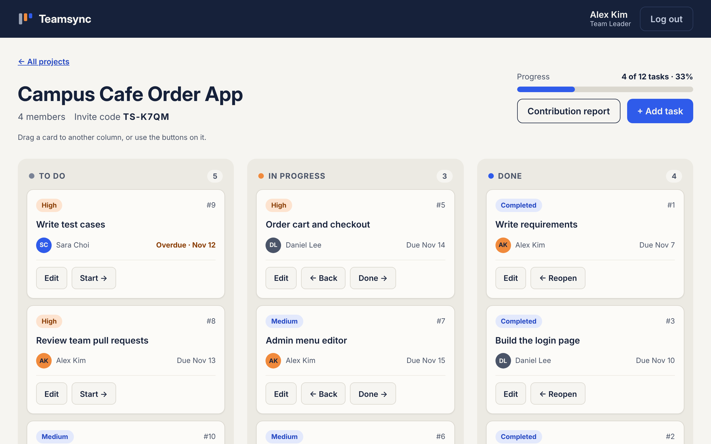
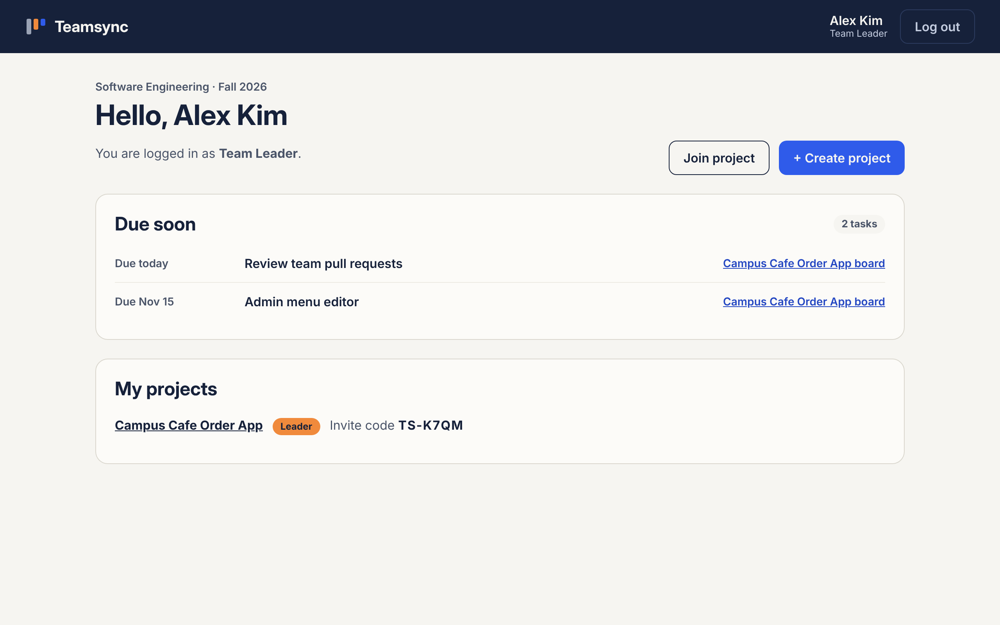
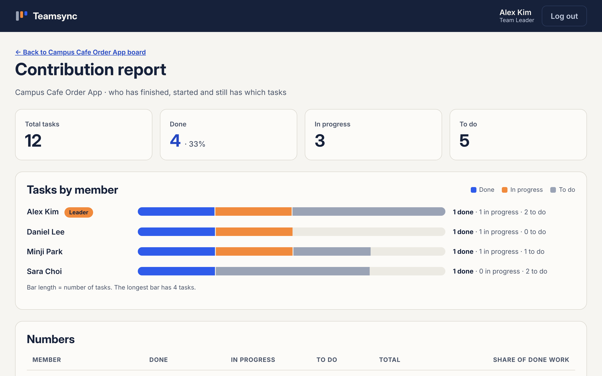
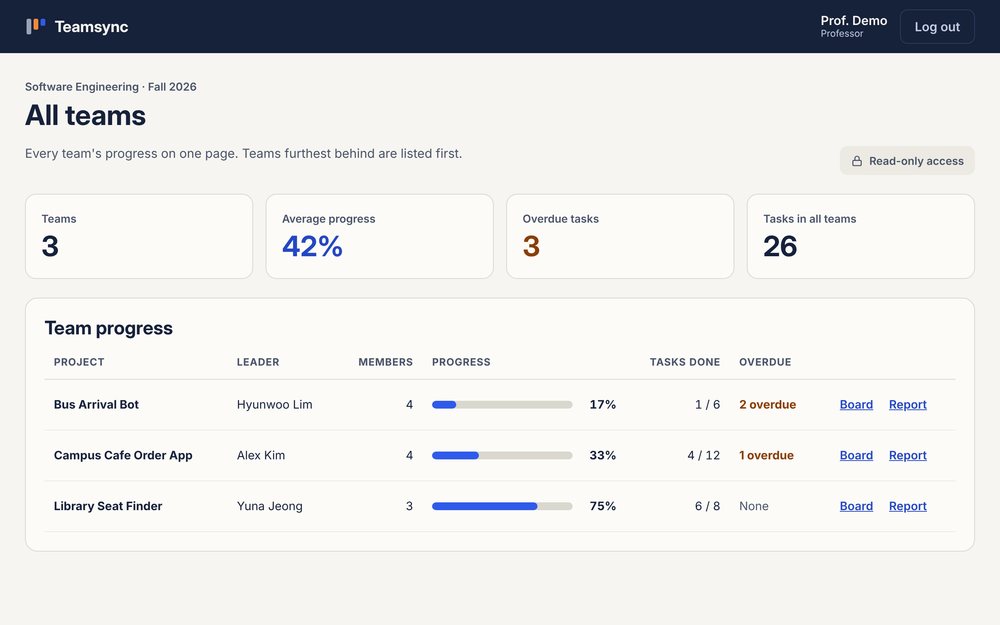

# Teamsync

**Student Team Project & Task Tracker**
Software Engineering team project · Dong-eui University · Fall 2026

[](https://github.com/kabirfahim19/Teamsync/actions/workflows/tests.yml)

Teamsync is a web application where a student team can plan, assign and track its tasks in one place, and where the professor can follow each team's progress.

**Live demo:** https://teamsync-du.fwh.is (sample data; log in as `alex@demo.test`, `minji@demo.test` or `prof@demo.test`, password `demo1234`)

**Status:** All 28 functional requirements and all 11 user stories are merged into `main`. The rest of Sprint 3 (until Nov 30) is for team testing, diagrams, slides and the user guide.



## Team

| Name | Student ID | Role in the project |
|---|---|---|
| Kabir Md Fahim | 20244154 | Team Leader, Scrum Master, developer |
| Miraj Md | 20244166 | UML and ER diagrams |
| Fahim Iftekhar Zaman | 20244229 | Test cases and testing |
| Hossain Md Fahim Al | 20244220 | Presentation slides and user guide |

## Features

| Feature | Who uses it | Issue |
|---|---|---|
| Sign up, log in and log out with three roles: Team Leader, Team Member, Professor | Everyone | Starter |
| Create a project and get a unique invite code (`TS-XXXX`) | Team Leader | #1 |
| Join a project with the invite code | Team Leader, Team Member | #2 |
| Kanban board with To Do, In Progress and Done, overdue marking and a progress bar | Team members | #3 |
| Add, edit and delete tasks with assignee, priority and due date | Team Leader | #4 |
| Contribution report: tasks done, in progress and to do per member, as a bar chart and a table | Team members, Professor | #9 |
| Professor dashboard: every team's progress and overdue tasks, read-only | Professor | #10 |
| "Due soon" list: your own tasks that are overdue or due within 2 days | Team members | #11 |
| Drag-and-drop cards between columns, saved without a reload | Team members | #12 |
| Email reminder to the assignee the day before a task is due | Team members | #28 |
| Signing up as Professor needs a secret professor code | Professor | #25 |
| Forgot password: a reset link by email that works once, for one hour | Everyone | #31 |
| Login protection: 5 wrong passwords block that email for 15 minutes | Everyone | #33 |
| Task comments: each task has its own page where the team discusses it; professors can read along | Team members, Professor | #37 |


## Screenshots

The screenshots use sample data.

| Dashboard with "Due soon" | Contribution report |
|---|---|
|  |  |

| Professor dashboard |
|---|
|  |

## Tech stack

| Layer | Technology |
|---|---|
| Frontend | HTML, CSS, JavaScript (no framework) |
| Backend | PHP 8 with PDO |
| Database | MySQL / MariaDB |
| Local server | XAMPP |

## Run it on your computer

1. Install [XAMPP](https://www.apachefriends.org/) and start **Apache** and **MySQL** from the XAMPP control panel.
2. Clone this repository into XAMPP's `htdocs` folder.

   macOS:
   ```
   cd /Applications/XAMPP/xamppfiles/htdocs
   git clone https://github.com/kabirfahim19/Teamsync.git
   ```
   Windows:
   ```
   cd C:\xampp\htdocs
   git clone https://github.com/kabirfahim19/Teamsync.git
   ```
3. Open `http://localhost/phpmyadmin` → **Import** → choose `database/schema.sql` → **Import**.
   This creates the `Teamsync` database and all its tables.
4. Copy `config/db.example.php` and rename the copy to `config/db.php`.
   The XAMPP defaults (user `root`, empty password) already work. `config/db.php` is in `.gitignore`, so passwords never go to GitHub.
5. Open `http://localhost/Teamsync`.
6. Optional, email (reminders and password reset): in `config/db.php` fill in `$MAIL_USER` (a Gmail address) and `$MAIL_PASS` (its App Password).

**Updating an older copy:** a database made with an older `schema.sql` needs the newer tables. Run each of these once, in phpMyAdmin's SQL tab, if your database does not have it yet: `database/add_reminders.sql`, `add_password_resets.sql`, `add_login_attempts.sql`, `add_task_comments.sql`.

## Try it

**Quick demo:** import `database/demo_data.sql` the same way as `schema.sql`. It adds 3 sample teams. Log in as `alex@demo.test` (Team Leader), `minji@demo.test` (Team Member) or `prof@demo.test` (Professor), password `demo1234`.

**Or step by step:**

1. **Sign up** as a Team Leader and **create a project**. Note its invite code.
2. In a private window, sign up as a Team Member and **join** with the invite code.
3. As the leader, **add tasks** and assign them to members.
   Optional: `database/sample_tasks.sql` adds 6 sample tasks to the newest project.
4. **Drag** a card to another column, or use its buttons.
5. Click a task's title to open it and **write a comment**. The card on the board shows how many comments it has.
6. Open the **Contribution report** from the board.
7. Sign up as a Professor to see **All teams**, then open any board, task or report (read-only).

## Put it online

The live demo runs on [InfinityFree](https://www.infinityfree.com) (free: PHP 8.3 and MySQL). Any host with PHP 8 and MySQL works the same way.

1. **Account and address.** Sign up, create a hosting account and pick a free subdomain (ours: `teamsync-du.fwh.is`).
2. **Database.** Control panel → **MySQL Databases** → create one. The control panel shows its host name, database name, user and password.
3. **Tables and demo data.** Open **phpMyAdmin** next to the database, select the database, then **Import** → `database/online.sql` → **Import**.
4. **Files.** Zip the app folder without `.git`, `.github`, `tests` and `config/db.php`. In the **Online File Manager**, go *inside* `htdocs` first, then **Upload & Extract** the zip (extracting works only inside `htdocs`).
5. **Settings.** In `htdocs/config`, copy `db.example.php` to `db.php` and fill in:
   - `$DB_HOST`, `$DB_NAME`, `$DB_USER`, `$DB_PASS` from step 2
   - `$PROFESSOR_CODE`: a secret code only the professor gets
   - `$MAIL_USER` and `$MAIL_PASS`: a Gmail address and its App Password, for reminders and password reset
   - `$SITE_URL`: the site's address, for the links in emails
6. Open the address. If the host's welcome page still shows, open `/index.php` once or hard refresh (Cmd + Shift + R).

**What free hosting does differently**

| On free hosting | What Teamsync does |
|---|---|
| PHP `mail()` does not work | Sends email through Gmail SMTP (PHPMailer) with an App Password |
| No scheduled jobs (cron) | Opening the dashboard sends the due reminders in the background |
| The database clock is in another time zone | Every date comes from PHP in Korean time, never from the database |
| A security check can answer with a web page instead of JSON | Drag-and-drop shows a clear message instead of failing silently |

**Updating the live site:** first run the new `database/add_*.sql` file in phpMyAdmin (**SQL** tab), then upload the changed files. The other way round, the new code would look for a table that does not exist yet.

## Testing

**Automated tests** check the app's rules without a browser: invite codes, task checks, who may move a task, overdue and due-soon dates, email reminders, the contribution report, password reset links, the login block and the security headers. Each test names its requirement or test case from the SRS, for example `TC-07` or `FR-27`.

Run them from the Teamsync folder:

```bash
php tests/run.php
# Mac XAMPP:     /Applications/XAMPP/xamppfiles/bin/php tests/run.php
# Windows XAMPP: C:\xampp\php\php.exe tests\run.php
```

The tests build a new SQLite database in memory, so they never touch your MySQL data and XAMPP does not need to be running. GitHub runs them on every push and pull request: see the **Actions** tab or the badge at the top of this page. A pull request with a red cross is not merged.

When you add a table or a column to `database/schema.sql`, add it to `tests/sqlite_schema.sql` too. A test checks that the two files match.

**Manual tests:** the pages themselves (forms, HTTP 403 answers, drag-and-drop) are tested by hand with test cases TC-01 to TC-28 in the SRS.

**Non-functional checks:** speed, security, permissions, accessibility and browser support (NFR-01 to NFR-16) were checked on Nov 20, 2026. The results are in [`docs/nfr-checks.md`](docs/nfr-checks.md).

## Folder structure

```
Teamsync/
├── index.php             Log in
├── register.php          Sign up
├── forgot_password.php   Ask for a password reset link
├── reset_password.php    Choose a new password with the link
├── logout.php            Log out (POST only)
├── dashboard.php         My projects and "Due soon"
├── create_project.php    New project with invite code
├── join_project.php      Join with an invite code
├── board.php             Kanban board of one project
├── task.php              One task and its comments
├── task_form.php         Add, edit or delete a task (leader only)
├── report.php            Contribution report
├── professor.php         All teams (professor only)
├── api/
│   ├── update_task.php   Moves a task; used by the buttons and by drag-and-drop
│   └── send_reminders.php  Sends due email reminders; the dashboard calls it in the background
├── config/
│   └── db.example.php    Database settings (copy to db.php)
├── includes/
│   ├── auth.php          Session, login and role checks, CSRF, escaping
│   ├── session.php       Session cookie settings (HttpOnly, Secure, SameSite)
│   ├── security_headers.php  What the browser may load; no framing by other sites
│   ├── projects.php      Projects, members, invite codes
│   ├── tasks.php         Tasks, board columns, due-soon list
│   ├── mail.php          Sending email over SMTP
│   ├── reminders.php     Email reminders (FR-19)
│   ├── password_resets.php  Password reset links (FR-26)
│   ├── login_guard.php   Blocks password guessing (FR-27)
│   ├── comments.php      Task comments (FR-28)
│   ├── reports.php       Contribution numbers
│   ├── header.php
│   └── footer.php
├── assets/
│   ├── css/style.css
│   └── js/app.js         Delete confirmation, drag-and-drop, sign-up form, reminder call
├── lib/
│   └── PHPMailer/        Sends email over SMTP (LGPL 2.1, unchanged)
├── database/
│   ├── schema.sql        Tables: users, projects, project_members, tasks, password_resets, login_attempts, task_comments
│   ├── sample_tasks.sql  Optional sample tasks
│   ├── demo_data.sql     Optional demo teams for presentations and testing
│   ├── online.sql        Every table plus the demo data, for web hosting (no CREATE DATABASE)
│   ├── add_reminders.sql Adds the reminder column to an older database
│   ├── add_password_resets.sql  Adds the password reset table to an older database
│   ├── add_login_attempts.sql   Adds the login protection table to an older database
│   └── add_task_comments.sql    Adds the task comments table to an older database
├── docs/
│   ├── Teamsync-Requirements-v1.4.pdf   Software Requirements Specification
│   ├── sprint-reviews.md                Sprint reviews and retrospectives
│   ├── nfr-checks.md                    Results of the non-functional requirement checks
│   └── screenshots/
├── tests/
│   ├── run.php           Automated tests: php tests/run.php
│   └── sqlite_schema.sql The tables, for the tests' in-memory database
└── .github/workflows/
    └── tests.yml         Runs the tests on GitHub at every push
```

## Database

| Table | Purpose |
|---|---|
| `users` | Everyone who can log in, with a role |
| `projects` | One row per team project, with its invite code and leader |
| `project_members` | Which user is in which project |
| `tasks` | Tasks on the Kanban board: assignee, status, priority, due date, when the reminder was sent |
| `password_resets` | Open password reset links (only a hash of each link) |
| `login_attempts` | Wrong-password tries of the last day, for the login block |
| `task_comments` | Comments on tasks: who wrote what, and when |

## How we work

We use **Scrum** with one-week sprints. Requirements, user stories, use cases and the traceability table are in [`docs/Teamsync-Requirements-v1.4.pdf`](docs/Teamsync-Requirements-v1.4.pdf). What we learned after each sprint is in [`docs/sprint-reviews.md`](docs/sprint-reviews.md).

Every user story is a GitHub **Issue** on the *Teamsync Sprint Board*. For each issue:

1. Get the latest code: `git checkout main` and `git pull`
2. Make a branch: `git checkout -b feature/<task-name>`
3. Run the tests: `php tests/run.php` (everything must pass)
4. Commit: `git add .` then `git commit -m "Add login form (closes #n)"`
5. Push: `git push -u origin feature/<task-name>`
6. Open a **Pull Request**. Wait for the green tick from the tests, review it and merge it into `main`. `closes #n` closes the issue.

**Definition of Done:** every acceptance criterion passes, the automated tests pass, the change is merged into `main` through a pull request, and the issue is closed.

## Security

- Passwords are stored with `password_hash()` and checked with `password_verify()`
- All database queries use PDO prepared statements (no SQL injection)
- Every form and every task move carries a CSRF token
- Every page checks the user's role and project membership; professors cannot change anything
- All output is escaped with `htmlspecialchars()` (no XSS)
- The session ID is renewed at login. The session cookie is `HttpOnly` (JavaScript cannot read it), `SameSite=Lax`, and `Secure` on https, and PHP refuses session IDs it did not create
- Every page sends security headers. The Content-Security-Policy lets scripts run only from our own files, so a script typed into a title or a comment cannot run even if escaping were missed. No other site may show Teamsync inside a frame (clickjacking), and links to other sites never get our page addresses
- After 5 wrong passwords for one email within 15 minutes, logging in to it is blocked for 15 minutes
- Signing up as Professor needs a secret code set in `config/db.php`
- Password reset links are random, stored only as a hash, work once and expire after one hour; the page never tells whether an email has an account
- Mail and database passwords stay in `config/db.php`, which is never uploaded to GitHub

## Schedule

Sprints 1 and 2 took far less time than planned, so Sprint 3 started early, on Nov 13. The planned dates are from the first plan; the actual dates are when the work was merged into `main`.

| Sprint | Planned | Actual | Work | Status |
|---|---|---|---|---|
| 0 | Nov 3 – 9 | Nov 8 | Setup, sign-up, login, roles | Done |
| 1 | Nov 10 – 16 | Nov 10 | Projects, invite codes, board, tasks | Done |
| 2 | Nov 17 – 23 | Nov 11 – 12 | Contribution report, professor view, due-soon list, drag-and-drop | Done |
| 3 | Nov 24 – 30 | Nov 13 – 30 | Nov 13 – 16: online site, professor code, email reminders, password reset, login protection, automated tests, task comments<br>Nov 17 – 25: SRS v1.4, non-functional checks, session cookie and security headers<br>Nov 24 – 30: team testing, UML and ER diagrams, slides, user guide | In progress |
| Week 14 | Dec 1 – 7 | | Final presentation and demo | – |

Sprint reviews and retrospectives: [`docs/sprint-reviews.md`](docs/sprint-reviews.md).
