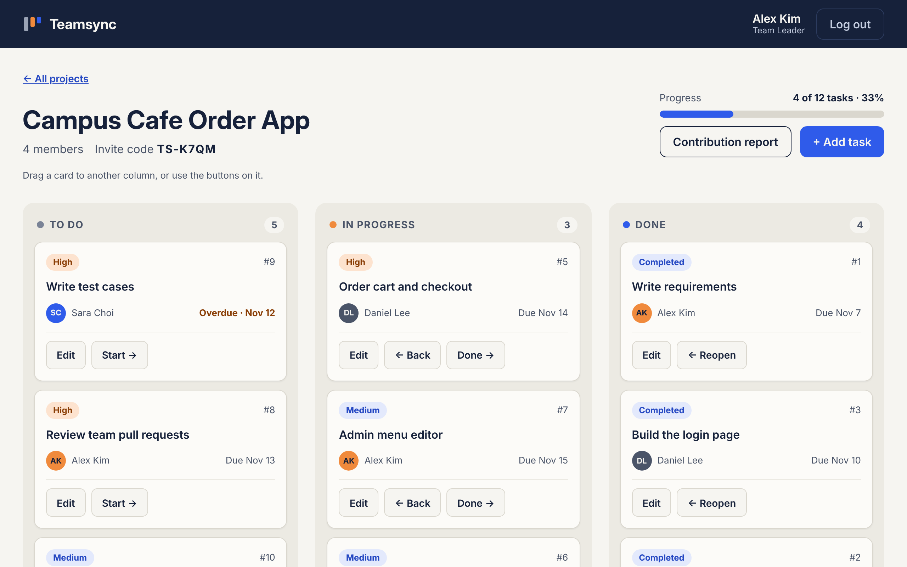
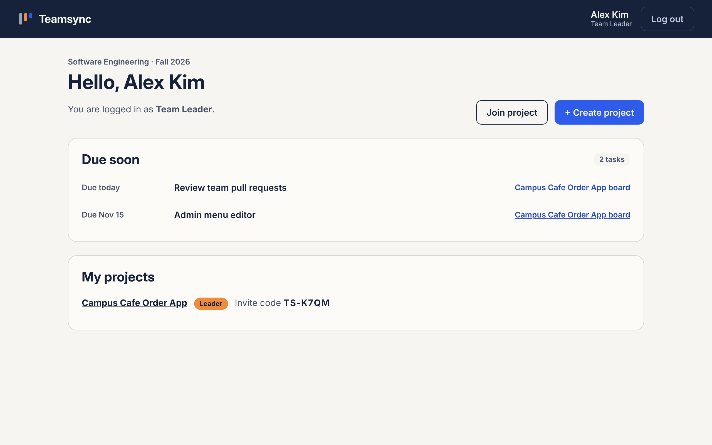
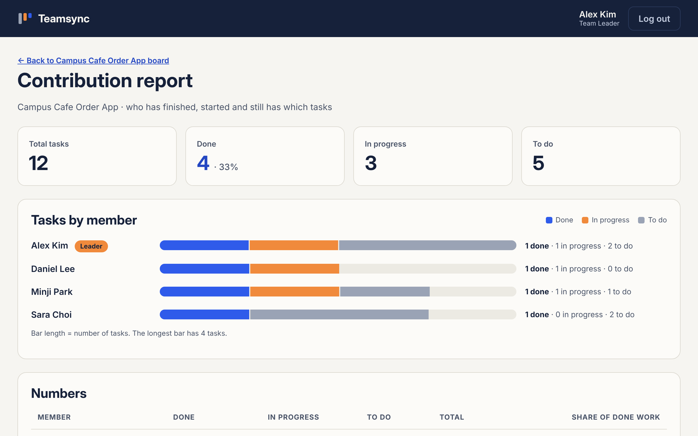
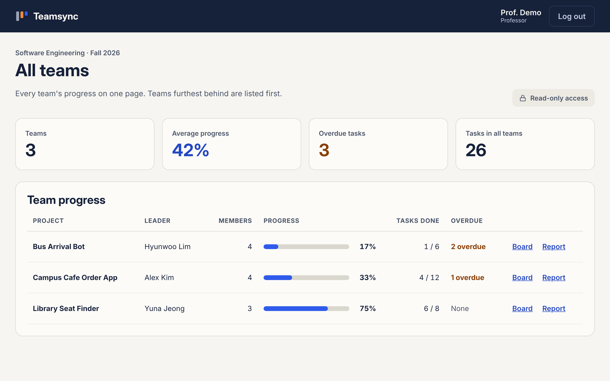

# Teamsync

**Student Team Project & Task Tracker**
Software Engineering team project · Dong-eui University · Fall 2026

Teamsync is a web application where a student team can plan, assign and track its tasks in one place, and where the professor can follow each team's progress.

**Status:** Sprints 0–2 are done. 23 of 24 functional requirements and all 9 user stories are merged into `main`. Sprint 3 (Nov 24 – 30) is for testing, diagrams and the final presentation.



## Team

| Name | Student ID | Role in the project |
|---|---|---|
| Kabir Md Fahim | 20244154 | Team Leader, Scrum Master, developer |
| Miraj Md | 20244166 | UML and ER diagrams |
| Fahim Iftekhar Zaman | 20244229 | Test cases and testing |
| Hossain Md Fahim Al | 20244220 | Presentation slides and user guide |

## Features

| Feature | Who uses it | Issue |
|---|---|---|
| Sign up, log in and log out with three roles: Team Leader, Team Member, Professor | Everyone | Starter |
| Create a project and get a unique invite code (`TS-XXXX`) | Team Leader | #1 |
| Join a project with the invite code | Team Leader, Team Member | #2 |
| Kanban board with To Do, In Progress and Done, overdue marking and a progress bar | Team members | #3 |
| Add, edit and delete tasks with assignee, priority and due date | Team Leader | #4 |
| Contribution report: tasks done, in progress and to do per member, as a bar chart and a table | Team members, Professor | #9 |
| Professor dashboard: every team's progress and overdue tasks, read-only | Professor | #10 |
| "Due soon" list: your own tasks that are overdue or due within 2 days | Team members | #11 |
| Drag-and-drop cards between columns, saved without a reload | Team members | #12 |

Not built yet: an email one day before a task's due date (FR-19, a *Could* requirement, kept in the backlog).

## Screenshots

The screenshots use sample data.

| Dashboard with "Due soon" | Contribution report |
|---|---|
|  |  |

| Professor dashboard |
|---|
|  |

## Tech stack

| Layer | Technology |
|---|---|
| Frontend | HTML, CSS, JavaScript (no framework) |
| Backend | PHP 8 with PDO |
| Database | MySQL / MariaDB |
| Local server | XAMPP |

## Run it on your computer

1. Install [XAMPP](https://www.apachefriends.org/) and start **Apache** and **MySQL** from the XAMPP control panel.
2. Clone this repository into XAMPP's `htdocs` folder.

   macOS:
   ```
   cd /Applications/XAMPP/xamppfiles/htdocs
   git clone https://github.com/kabirfahim19/Teamsync.git
   ```
   Windows:
   ```
   cd C:\xampp\htdocs
   git clone https://github.com/kabirfahim19/Teamsync.git
   ```
3. Open `http://localhost/phpmyadmin` → **Import** → choose `database/schema.sql` → **Import**.
   This creates the `Teamsync` database and its four tables.
4. Copy `config/db.example.php` and rename the copy to `config/db.php`.
   The XAMPP defaults (user `root`, empty password) already work. `config/db.php` is in `.gitignore`, so passwords never go to GitHub.
5. Open `http://localhost/Teamsync`.

## Try it

1. **Sign up** as a Team Leader and **create a project**. Note its invite code.
2. In a private window, sign up as a Team Member and **join** with the invite code.
3. As the leader, **add tasks** and assign them to members.
   Optional: `database/sample_tasks.sql` adds 6 sample tasks to the newest project.
4. **Drag** a card to another column, or use its buttons.
5. Open the **Contribution report** from the board.
6. Sign up as a Professor to see **All teams**, then open any board or report (read-only).

## Folder structure

```
Teamsync/
├── index.php             Log in
├── register.php          Sign up
├── logout.php            Log out (POST only)
├── dashboard.php         My projects and "Due soon"
├── create_project.php    New project with invite code
├── join_project.php      Join with an invite code
├── board.php             Kanban board of one project
├── task_form.php         Add, edit or delete a task (leader only)
├── report.php            Contribution report
├── professor.php         All teams (professor only)
├── api/
│   └── update_task.php   Moves a task; used by the buttons and by drag-and-drop
├── config/
│   └── db.example.php    Database settings (copy to db.php)
├── includes/
│   ├── auth.php          Session, login and role checks, CSRF, escaping
│   ├── projects.php      Projects, members, invite codes
│   ├── tasks.php         Tasks, board columns, reminders
│   ├── reports.php       Contribution numbers
│   ├── header.php
│   └── footer.php
├── assets/
│   ├── css/style.css
│   └── js/app.js         Delete confirmation and drag-and-drop
├── database/
│   ├── schema.sql        Tables: users, projects, project_members, tasks
│   └── sample_tasks.sql  Optional sample tasks
├── docs/
│   ├── Teamsync-Requirements-v1.1.pdf   Software Requirements Specification
│   ├── sprint-reviews.md                Sprint reviews and retrospectives
│   └── screenshots/
└── tests/                Test cases (Sprint 3)
```

## Database

| Table | Purpose |
|---|---|
| `users` | Everyone who can log in, with a role |
| `projects` | One row per team project, with its invite code and leader |
| `project_members` | Which user is in which project |
| `tasks` | Tasks on the Kanban board: assignee, status, priority, due date |

## How we work

We use **Scrum** with one-week sprints. Requirements, user stories, use cases and the traceability table are in [`docs/Teamsync-Requirements-v1.1.pdf`](docs/Teamsync-Requirements-v1.1.pdf). What we learned after each sprint is in [`docs/sprint-reviews.md`](docs/sprint-reviews.md).

Every user story is a GitHub **Issue** on the *Teamsync Sprint Board*. For each issue:

1. Get the latest code: `git checkout main` and `git pull`
2. Make a branch: `git checkout -b feature/<task-name>`
3. Commit: `git add .` then `git commit -m "Add login form (closes #n)"`
4. Push: `git push -u origin feature/<task-name>`
5. Open a **Pull Request**, review it and merge it into `main`. `closes #n` closes the issue.

**Definition of Done:** every acceptance criterion passes, the change is merged into `main` through a pull request, and the issue is closed.

## Security

- Passwords are stored with `password_hash()` and checked with `password_verify()`
- All database queries use PDO prepared statements (no SQL injection)
- Every form and every task move carries a CSRF token
- Every page checks the user's role and project membership; professors cannot change anything
- All output is escaped with `htmlspecialchars()` (no XSS)
- The session ID is renewed at login

## Schedule

| Sprint | Dates | Work | Status |
|---|---|---|---|
| 0 | Nov 3 – 9 | Setup, sign-up, login, roles | Done |
| 1 | Nov 10 – 16 | Projects, invite codes, board, tasks | Done (Nov 10) |
| 2 | Nov 17 – 23 | Report, professor view, reminders, drag-and-drop | Done early (Nov 12) |
| 3 | Nov 24 – 30 | Testing, bug fixes, UML/ER update, slides | Next |
| Week 14 | Dec 1 – 7 | Final presentation and demo | – |
