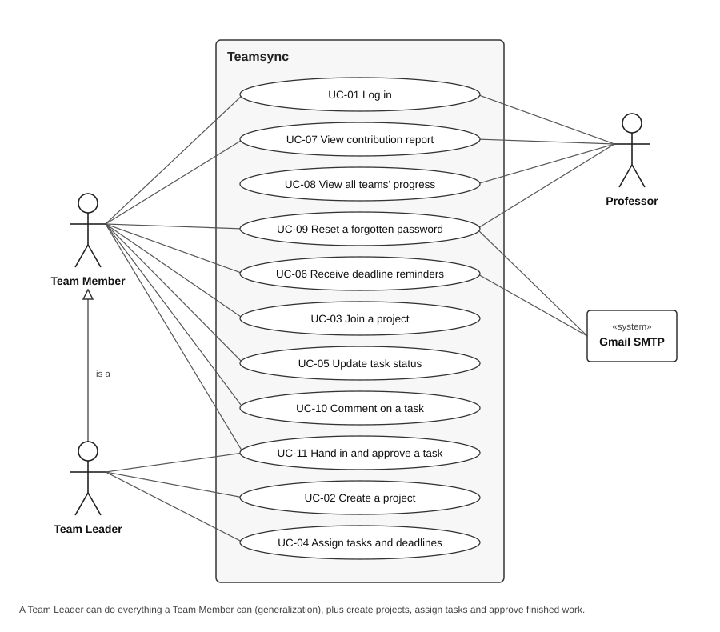
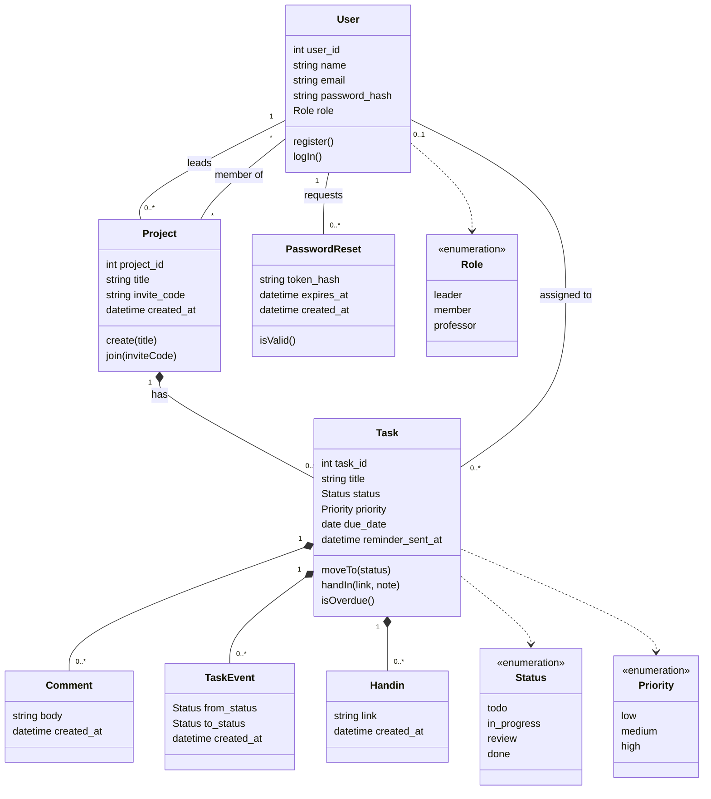
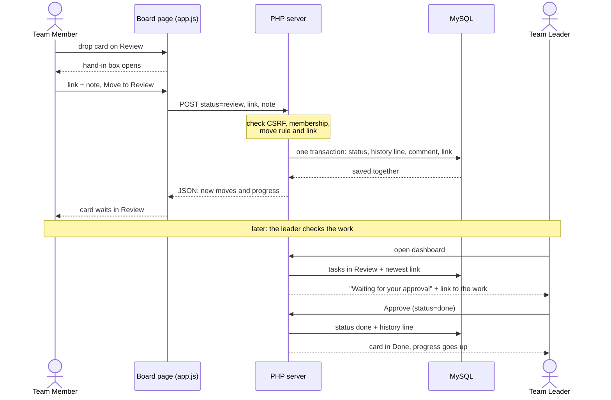
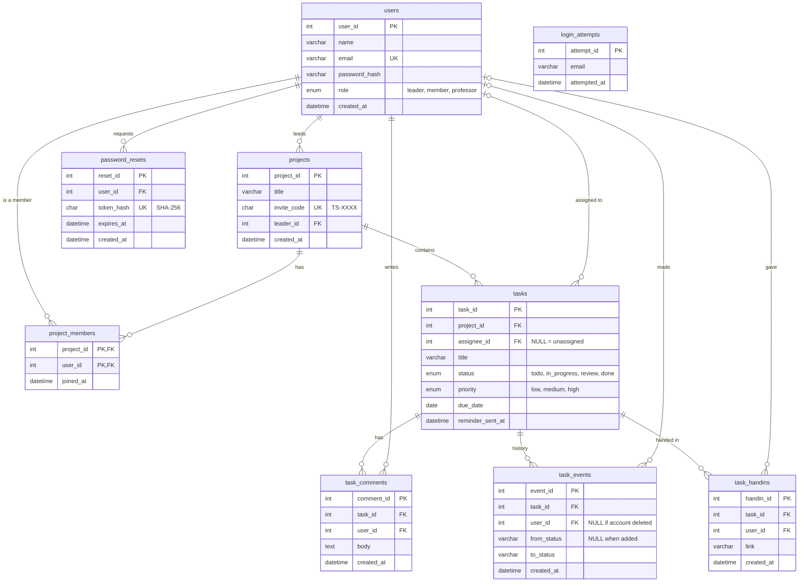

# Teamsync diagrams

UML and ER diagrams of Teamsync, matching the code on `main` (Sprint 3, Nov 2026). Requirements, use case descriptions and test cases are in the SRS: [`docs/Teamsync-Requirements-v1.5.pdf`](../Teamsync-Requirements-v1.5.pdf).

The class, sequence and ER diagrams are written in [Mermaid](https://mermaid.js.org/), so GitHub draws them from the text below, and a change to a diagram goes through a pull request like a change to the code. PNG copies of every diagram are in this folder for slides and documents.

| Diagram | What it shows | Files |
|---|---|---|
| Use case | The 11 use cases, the three user roles and the email service | `use-case.svg`, `use-case.png` |
| Class | The 7 core classes, their attributes, operations and associations | `class.png` |
| Sequence | UC-11: a member hands in a task with a link, and the leader approves it | `sequence.png` |
| ER | The 9 database tables, their keys and relationships | `er.png` |

## Use case diagram

A Team Leader can do everything a Team Member can (the generalization arrow), plus create projects, assign tasks and approve finished work. The Professor only reads. Gmail SMTP is the outside system that delivers reminder and password reset emails.

## Class diagram

Each class is one database table, and its operations are PHP functions in `includes/` (for example `Task.moveTo()` is `move_task()` in `includes/tasks.php`). A filled diamond means the part is deleted with its whole.

Comment, TaskEvent and Handin also each belong to the User who wrote or made them; those three links are left out to keep the diagram readable. LoginAttempt (wrong-password tries per email, FR-27) has no links and is not drawn.

## Sequence diagram: UC-11 hand in and approve a task

Every check runs on the server before anything is saved, and the move, its history line, the comment and the link are saved in one transaction (FR-29 to FR-31).

## ER diagram

The tables as created by [`database/schema.sql`](../../database/schema.sql). `login_attempts` has no foreign key: it is looked up by email (FR-27).

